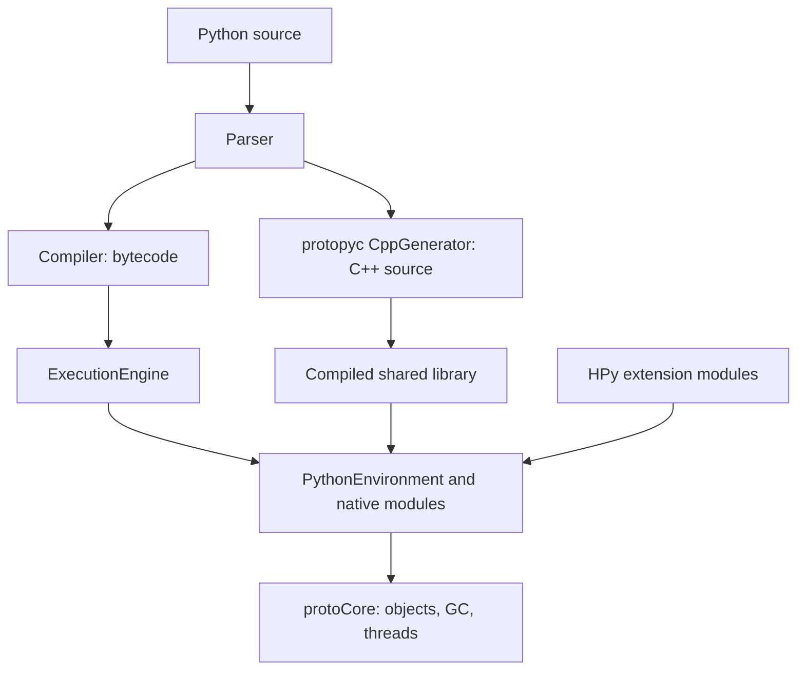

# protoPython: GIL-Free Python 3.14 Runtime

[](https://isocpp.org/)
[](https://cmake.org/)
[](CHANGELOG.md)
[](#project-status)
[](LICENSE)

**protoPython** is a Python runtime built on
[**protoCore**](https://github.com/numaes/protoCore). It targets Python 3.14
semantics, ships the CPython 3.14 pure-Python standard library in
`lib/python3.14/`, and runs without a Global Interpreter Lock: Python threads are
native OS threads created through protoCore's `ProtoSpace::newThread`
(`src/library/ThreadModule.cpp`), and collections are built on protoCore's
immutable, structurally shared data structures.

protoPython provides three components:

- **protopy** — the command-line runtime: source is parsed, compiled to bytecode and
  executed by the `ExecutionEngine`.
- **protopyc** — an ahead-of-time compiler that translates Python modules into C++
  source and shared libraries that call into the same runtime.
- **libprotoPython** — the shared library behind both, for embedding in C++
  applications.

---

## Project Status

- **Version:** 1.0.0 (`CMakeLists.txt`, tag `v1.0.0`).
- **Maturity:** not production ready. The project is open for community review.
- **Tests:** the CTest suite has 882 tests when it builds protoCore 2.14.5 from `../protoCore` (protoPython's own plus protoCore's); CI pins protoCore 2.14.5 and runs the gating tests in a Release build (the 13 clock-dependent cases run in a separate, informational job). protoCore's own controller tests `AdaptiveHeapSteady.HeapStaysFarBelowTheGarbageVolume` and `AdaptiveHeapStorm.SoftLimitSettlesWithinBoundedCycles` have each failed a first CI attempt on the runner and passed on the second (runs 38104389529, 38113972723, 38115542237); since protoCore 2.14.4 the first gates deterministically and the second skips itself in this configuration. Locally, against protoCore 2.14.5 built from `../protoCore` (2026-10-11): 882 of 882 in Release; 880 of 882 under AddressSanitizer **with leak detection on** and no report (`protopy_re_results_not_interned` and `adaptive_heap_bounded_memory` measure memory and fail under ASan's 256 MB free-memory quarantine; both pass with `ASAN_OPTIONS=quarantine_size_mb=1`). Until protoCore 2.14.5, LeakSanitizer reported protoCore's retained memory at exit in every protopy test (with the 2.14.3 library swapped in, the same binary reports about 90 KB in 1,400 allocations for a one-line script); 2.14.5 keeps that memory reachable.
- **protopy:** under active conformance work (see below).
- **protopyc:** experimental, with known limitations. Several correctness bugs in
  generated code were fixed in 2026 (for example, loop-target scoping and thread
  globals in commit `eab663bd`, and `and`/`or` lowering in commit `1084f969`);
  check the results of compiled modules against `protopy` before relying on them.
  Since 2026-10-11 generated code keeps every object it uses visible to the
  collector: each compiled call runs in its own context with its locals and
  temporaries in automatic slots
  ([issue #2](https://github.com/gamarino/protoPython/issues/2); before that a
  compiled module with an allocating loop crashed once collections ran, which
  protopy's adaptive heap controller makes the default). Compiled generators
  (`send`, `throw`, `close`, `yield from`) and compiled code called from
  another module (which resolves names in its own module) work since
  2026-10-11, as do exception propagation (a raising statement stops its
  statement list; `finally` clauses run on exceptions, `return`, `break` and
  `continue`), `with` statements (`__enter__`/`__exit__`, suppression) and the
  methods of classes defined in functions, which keep their closure when called
  on an instance. Attribute reads apply Python's rules (descriptors,
  `__getattr__`, `AttributeError`), and compiled classes are built by the
  interpreter's class machinery (their own `__mro__`, metaclasses, `Enum`,
  dataclasses, interpreted subclasses), also since 2026-10-11. Compiled
  closures hold cells, as the interpreter's do (late binding, `nonlocal`, `del`,
  recursive nested functions without a cycle per call), and compiled functions
  bind arguments as CPython does (keywords, defaults evaluated at the
  definition, keyword-only and positional-only parameters, `*args`, `**kwargs`,
  CPython's `TypeError`s). Known limitations are listed in
  [docs/PROTOPYC_SPECIFICATION.md](docs/PROTOPYC_SPECIFICATION.md), section 5.

### CPython conformance

[docs/CPYTHON_CONFORMANCE.md](docs/CPYTHON_CONFORMANCE.md) records the current
status (2026-09-14). Conformance work runs the same script under `python3` and
`protopy`, diffs the outputs, and fixes each defect in a commit that adds a
regression test under `test/regression/`. Recent fixes include PEP 695 generics,
zero-argument `__class__` in methods, `import asyncio`, `nonlocal` rebinding and
`@dataclass(slots=True)`.

Its [known divergences](docs/CPYTHON_CONFORMANCE.md#known-divergences-pending)
list what is still pending, for example:

- "`frozen=True` fails in `__init__`" for dataclasses;
- "`inspect.getclosurevars` fails because `dis` cannot decode protoPython bytecode";
- "`gc.collect()` is a no-op (protoCore collects under heap pressure only)";
- "sets and dicts treat two distinct keys with equal hashes as the same key
  (accepted limitation)".

Earlier conformance reports, including the `test_descr.py` work, are kept in
[docs/archive/CPYTHON_CONFORMANCE_HISTORY.md](docs/archive/CPYTHON_CONFORMANCE_HISTORY.md).

---

## Key Features

- **No GIL.** Each Python thread is a native OS thread, and threads run Python code in
  parallel. protoCore provides per-thread allocation arenas and a concurrent garbage
  collector.
- **Immutable core structures.** Lists, tuples, strings and dictionaries are backed by
  protoCore's structurally shared collections (AVL trees and ropes). List mutators
  publish their new state atomically across threads (commit `1614224f`).
- **Two execution modes, one runtime.** `protopy` interprets bytecode; `protopyc`
  compiles modules to C++ ahead of time. Both call the same `libprotoPython` runtime.
- **HPy-style extensions.** `import` loads extension modules written against
  protoPython's HPy-style C++ API (a subset, not the HPy universal ABI); see
  [docs/HPY_USER_GUIDE.md](docs/HPY_USER_GUIDE.md).
- **Embedding.** `PythonEnvironment` exposes the runtime to C++ applications; see
  [docs/CPP_API_REFERENCE.md](docs/CPP_API_REFERENCE.md).

Supported syntax, built-in types and modules, and differences from CPython are
described in [docs/PYTHON_COMPATIBILITY.md](docs/PYTHON_COMPATIBILITY.md).

---

## Quick Start

### Build

protoPython builds protoCore from a sibling `../protoCore` checkout unless
`PROTO_CORE_PREFIX` points to an installed protoCore (`CMakeLists.txt`). For
platform-specific instructions, install prefixes and library paths, see the
[**Installation Guide**](docs/INSTALLATION.md).

```bash
git clone https://github.com/gamarino/protoPython.git
git clone https://github.com/numaes/protoCore.git
cd protoPython

cmake -B build -S . -DCMAKE_BUILD_TYPE=Release
cmake --build build

# Run the test suite
ctest --test-dir build --output-on-failure
```

Use a Release build for any performance measurement.

**Running without installing:** RPATH is set, so the executables find the shared
libraries from the build tree without `LD_LIBRARY_PATH`. See
[Running from the build tree](docs/INSTALLATION.md#running-from-the-build-tree).

#### Windows (MSVC)

protoPython builds and runs natively on Windows with Visual Studio 2022, against
an installed protoCore (3.0.0 or newer). From an "x64 Native Tools Command Prompt":

```bat
cmake -S . -B build -G Ninja -DCMAKE_BUILD_TYPE=Release -DCMAKE_PREFIX_PATH=<protocore-prefix>
cmake --build build
ctest --test-dir build -j8
build\bin\protopy example.py
```

Executables and DLLs (including a copy of protoCore's DLL, `protoCore-3.dll` from
protoCore 2.9.0 on, `protoCore.dll` before) are in `build\bin`. The
script tests need Git for Windows' `bash`. `os` is `nt` there, as in CPython;
subprocesses and protopyc's module build are not available yet. See
[Windows (MSVC)](docs/INSTALLATION.md#windows-msvc) for installing, the differences
and what is not ported.

### Run a Python script

```python
# example.py
l = [1, 2]
l.append(3)
print("Updated list:", l)

s = "Hello World"
print("Starts with 'Hello':", s.startswith("Hello"))
```

```bash
./build/src/runtime/protopy example.py
# Updated list: [1, 2, 3]
# Starts with 'Hello': True
```

### Command line

| Invocation | Effect |
|---|---|
| `protopy script.py` | Run a script. |
| `protopy -c "<code>"` | Run a program passed as a string. |
| `protopy -m <module>` | Run a module as a script. |
| `protopy -i` / `protopy --repl` | Start the interactive REPL. |
| `protopy -p <dir>` / `--path <dir>` | Append a module search path (repeatable). |
| `protopy --help` | Show all options. |

The environment variable `PROTO_PYTHONPATH` adds module search paths. Running
`protopy` with no arguments starts the REPL when standard input is a terminal and
otherwise runs the program read from standard input (`echo 'print(1)' | protopy`),
as CPython does; `protopy - [args...]` always reads the program from standard input.

Exit status: `0` on success, `64` for a usage error, `65` when the script or module
cannot be resolved, `70` for an unhandled runtime failure, and `n` when the program
raises `SystemExit(n)` (also with `-c`).

### Memory

`protopy` runs protoCore's adaptive heap controller (protoCore
[docs/GarbageCollector.md](https://github.com/numaes/protoCore/blob/master/docs/GarbageCollector.md),
"Adaptive heap controller"). The heap budget is **75 % of the smaller of
physical memory and the process memory limit** (the cgroup limit on Linux, the
job object's on Windows); within it, a soft limit starts at 128 MiB of cells and
grows only while the program waits for the collector, so a program that
allocates much more than it keeps runs in a bounded heap. **Memory is not
returned to the operating system**: the resident size stays at the run's
high-water mark. A program whose live data exceeds the budget stops with
protoCore's out-of-memory message.

| Environment variable | Effect |
|---|---|
| `PROTOCORE_HEAP_LIMIT_CELLS=<hard>` or `<soft>,<hard>` | Sets the budget (and the initial soft limit) in 64-byte cells; `1000000` is about 64 MiB. |
| `PROTOCORE_ADAPTIVE_HEAP=0` | Turns the controller off: the budget becomes a fixed hard limit. |
| `PROTOCORE_ADAPTIVE_HEAP_START=budget` | Starts the soft limit at the budget, for a run known to fit. |
| `PROTOCORE_HEAP_TRACE=1` | Prints one line per collection cycle on standard error. |

Two kinds of object are never collected, by protoCore's design (protoCore
`docs/MemoryModel.md`, section 7, and embedder rule 5):

- **A cycle among mutable objects.** protoPython creates none per call: closures
  hold cells, not frames, and a recursive nested function finds itself without
  a cell (`docs/INTERNALS_DEEP_DIVE.md`, "Closures"). The program's own cycles
  stay for the life of the process: mutually recursive or decorated recursive
  nested functions (one cycle per definition), a class (its `__mro__` and
  `__class__` cell hold it), a list that contains itself.
- **A tuple** is no longer one: since 2026-10-12 a Python tuple is an immutable
  object holding its items in a `ProtoList`, collected like any other object
  (`PythonEnvironment::makeTuple`). It was a protoCore `ProtoTuple`, which
  protoCore interns and never frees: a loop building tuples of new objects
  (`*args`, `return (a, b)`, `dict.items()`) kept them all, about 10 cells per
  call. `protopy_tuple_bounded_memory` runs such a loop in a fixed 1 M-cell
  heap. Tuples built once at start-up or by the compiler (code-object
  constants, `__mro__`, `__bases__`) are still `ProtoTuple`s.

Before this default, protopy set no limit and protoCore never started a
collection by itself, so the heap grew with every allocation. Embedders that
create their own `proto::ProtoSpace` keep protoCore's default; the controller is
enabled on the process space `PythonEnvironment` uses.

### Compile a module with protopyc

```bash
./build/src/compiler/protopyc example.py --build-so
```

`protopyc <source_path>` accepts `--emit-cpp` (C++ sources and headers only),
`--emit-make` (C++ sources plus a Makefile) and `--build-so` (the full pipeline, up to
a shared library). See [docs/PROTOPYC_SPECIFICATION.md](docs/PROTOPYC_SPECIFICATION.md).

---

## Performance

**protoCore 2.14.8 (measured 2026-10-20).** `benchmarks/run_4way_interleaved.py`,
`main` at `4f8ab5bb` (which adds the STORE_ATTR change below), Release, built
against protoCore 2.14.8; three rounds, each behind a quiet gate (1.1-1.3 busy
CPUs) and on a fresh copy of the library; medians of the three rounds. Ratios
are to free-threaded CPython 3.14t (> 1: protoPython is slower); the last
columns are the 2026-10-18 run on protoCore 2.14.7.

| Benchmark | CPython 3.14t ms | protopy ms | protopy ratio | protopyc ms | protopyc ratio | 2.14.7: protopy / protopyc |
|---|---:|---:|---:|---:|---:|---:|
| `startup_empty` | 21.7 | 21.0 | 0.97x | — | — | 0.92x / — |
| `int_sum_loop` | 478.7 | 495.7 | 1.03x | 292.0 | 0.61x | 1.02x / 0.64x |
| `list_append_loop` | 23.2 | 142.8 | 6.14x | 160.3 | 6.91x | 5.84x / 6.67x |
| `str_concat_loop` | 22.7 | 131.2 | 5.85x | 200.3 | 8.89x | 5.57x / 8.79x |
| `range_iterate` | 284.6 | 521.8 | 1.83x | 320.0 | 1.08x | 1.78x / 1.08x |
| `multithread_cpu` | 171.3 | 109.5 | **0.65x** | 43.4 | **0.25x** | 0.65x / 0.28x |
| `attr_lookup` | 336.4 | 2054.6 | 6.10x | 1088.1 | 3.22x | 6.25x / 3.26x |
| `call_recursion` | 32.7 | 184.3 | 5.64x | 153.5 | 4.76x | 5.71x / 4.62x |
| `pyperf_fib` | 83.4 | 395.2 | 4.58x | — | — | 4.59x / — |
| `pyperf_binary_trees` | 33.3 | 486.5 | 14.64x | — | — | 14.47x / — |
| `pyperf_nqueens` | 49.6 | 119.7 | 2.41x | — | — | 2.37x / — |
| `pyperf_richards_lite` | 24.8 | 40.5 | 1.62x | — | — | 1.68x / — |
| `pyperf_sieve` | 25.2 | 93.1 | 3.64x | — | — | 3.48x / — |
| `memory_pressure` (informational) | 51.0 | 1451.9 | 28.9x | 1589.1 | 31.5x | 29.9x / 31.7x |
| **Geomean** (harness, `memory_pressure` excluded) | | | **2.97x** | | **2.05x** | 2.93x / 2.07x |

Nothing moved beyond the spread: protoCore 2.14.8's context slot stack helps
embedders that allocated a call's slots on the heap, and protoPython keeps them
in its frames already; the STORE_ATTR change (no `__mro__` walk on every
attribute store) does not reach these workloads measurably (`attr_lookup`
reads). On four CPU-bound threads (`multithread_cpu`) protoPython is 1.5x
(protopy) to 4x (protopyc) faster than CPython 3.14t; single-threaded it is
level on `int_sum_loop` and 1.6-15x slower on the rest, 3x (protopy) and 2x
(protopyc) on the geomean. Raw results:
[`benchmarks/reports/2026-10-20/`](benchmarks/reports/2026-10-20/).

**protoCore 2.14.7 (measured 2026-10-19).** 2.14.7 changes the write path: a
new value for an existing key copies the root-to-key path without rebalancing,
and allocating a cell no longer takes a spinlock. The same binaries on
protoCore 2.14.6 and 2.14.7, each run loading a fresh copy of the library,
three rounds: `benchmarks/run_4way_interleaved.py` against CPython 3.14t moves
the ratio by -0.2 % (protopy, geomean of 14 workloads) and -0.8 % (protopyc,
8), within the harness's A/A spread except protopyc `memory_pressure` (-11.7
%, informational); an attribute write (`o.x = v` in a loop) costs 2,578 cycles
against 2,720 (-5 %, A/A 0.4 %). Measured under TLP's battery power profile
(powersave, EPP balance_power): compare ratios, not absolute times, with older
figures. Details: [protoCore's
report](https://github.com/numaes/protoCore/blob/master/docs/reports/2026-10-18-write-path.md).

**protoCore 2.14.6 (measured 2026-10-13).**  protoCore no longer allocates a
temporary for `%`, `//` and unary minus on two SmallIntegers.  Loops of
2,000,000 iterations doing one operation each, protopy, the same commit
(`e1c88f73`) built against protoCore 2.14.5 and 2.14.6, `perf stat` cycles:
`%` -18.7 %, `//` -16.5 %, unary minus -3.8 % (A/A floor <= 0.6 %);
comparisons are unchanged (protoPython has its own SmallInteger path).
`benchmarks/run_4way_interleaved.py` against CPython 3.14t, three rounds,
moves within its noise because none of its workloads divides:
`int_sum_loop` 1.07 -> 1.00x, `pyperf_sieve` 3.60 -> 3.53x, `range_iterate`
1.83 -> 1.79x CPython-t's time. Measured under TLP's battery power profile (powersave, EPP balance_power): compare ratios, not absolute times, with older figures.  Details: [protoCore's report](https://github.com/numaes/protoCore/blob/master/docs/reports/2026-10-12-cross-runtime-int-compare.md).

protoPython is slower than CPython on most single-threaded workloads. The most recent
full measurement is
[benchmarks/reports/2026-06-16-full-stack-cpp-proto-python.md](benchmarks/reports/2026-06-16-full-stack-cpp-proto-python.md),
produced by [benchmarks/run_full_stack.py](benchmarks/run_full_stack.py).

**Method (as stated by the report and the harness):**

- Baseline 1.0 = CPython 3.14t (free-threading, GIL off). `cp` and `cpt` are
  CPython 3.14 with the GIL on and off (uv builds).
- Python variants report inner time, parsed from the `BENCH_RESULT ms=` line each
  benchmark prints; this excludes interpreter startup and the GC tail. protoCpp
  binaries report wall-clock time.
- Every variant of a benchmark uses the same workload size, matching the
  [protoCpp](https://github.com/gamarino/protoCpp) benchmarks: `int_sum_loop`
  N = 10,000,000; `attr_lookup` N = 5,000,000; `list_append_loop` N = 10,000;
  `str_concat_loop` N = 2,000; `call_recursion` N = 25; `multithread_cpu`
  4 threads × 2,000,000 iterations.
- Binaries run interleaved: one warm-up run, then three measured runs; the median is
  reported.

Columns: `cpp` pure C++ (no protoCore); `proto` protoCore driven directly from C++;
`proto_fast` protoCore with API-side optimisations; `protopy` the protoPython bytecode
interpreter; `protopyc` protoPython compiled to C++.

**Absolute time (ms), 2026-06-16:**

| Bench | cpp | proto | proto_fast | cp | cpt | protopy | protopyc |
|---|---:|---:|---:|---:|---:|---:|---:|
| int_sum_loop | 4.72 | 105.60 | 56.69 | 413.98 | 541.22 | 672.41 | N/A |
| attr_lookup | 6.80 | 300.94 | N/A | 389.44 | 372.59 | 2703.94 | 5022.64 |
| list_append_loop | 3.20 | 17.50 | N/A | 0.66 | 0.96 | 18.73 | 21.89 |
| str_concat_loop | 2.54 | 14.93 | N/A | 0.15 | 0.09 | 4.09 | 91.62 |
| call_recursion | 1.49 | 34.74 | 15.43 | 9.40 | 10.16 | 74.09 | 34.24 |
| multithread_cpu | 3.68 | 35.33 | 26.19 | 563.88 | 160.63 | 307.03 | 0.74 † |

**Ratios vs CPython 3.14t, 2026-06-16** (lower is faster):

| Bench | cpp | proto | proto_fast | cp | cpt | protopy | protopyc |
|---|---:|---:|---:|---:|---:|---:|---:|
| int_sum_loop | 0.01x | 0.20x | 0.10x | 0.76x | 1.00x | 1.24x | N/A |
| attr_lookup | 0.02x | 0.81x | N/A | 1.05x | 1.00x | 7.26x | 13.48x |
| list_append_loop | 3.34x | 18.23x | N/A | 0.69x | 1.00x | 19.51x | 22.80x |
| str_concat_loop | 28.20x | 165.84x | N/A | 1.67x | 1.00x | 45.44x | 1017.99x |
| call_recursion | 0.15x | 3.42x | 1.52x | 0.93x | 1.00x | 7.29x | 3.37x |
| multithread_cpu | 0.02x | 0.22x | 0.16x | 3.51x | 1.00x | 1.91x | 0.00x † |
| **Geomean** | **0.19x** | **2.67x** | **0.30x** | **1.20x** | **1.00x** | **6.94x** | 5.47x † |

† **The protopyc column of this report is not a valid measurement.** Commit
`ba763167`, which brought these figures into the README, records the column as
"unreliable: silent failures on 3 of 6 benches". Commit `eab663bd` identifies the causes: a for-loop target scoping bug
in generated functions, and spawned threads that raised on every global lookup and
"died before any side effect". The 0.74 ms `multithread_cpu` figure therefore does
not measure the workload, and the 5.47x geomean includes it.

### Changes measured after this report

These figures come from the commit messages that introduced the changes; no dated
report reproduces them.

- **Peephole specialiser (commit `48d81bbd`, 2026-06-16).** A post-codegen pass fuses
  three loop-shaped opcode sequences into single opcodes with an inline small-integer
  fast path. Setting `PROTOPY_NO_PEEPHOLE=1` disables it for A/B comparison on the
  same binary. The commit reports, vs CPython 3.14t: `int_sum_loop` 1.15x → 0.76x,
  `multithread_cpu` 1.68x → 0.41x, `call_recursion` 6.74x → 6.07x, `attr_lookup`
  6.30x → 5.83x, `list_append_loop` 20.46x → 20.15x, `str_concat_loop`
  50.25x → 49.88x; geomean 6.62x → 4.72x.
- **protopyc fixes (commit `eab663bd`, 2026-06-16).** The commit reports protopyc
  readings vs CPython 3.14t of 0.92x (`int_sum_loop`), 3.95x (`attr_lookup`), 19.11x
  (`list_append_loop`), 972x (`str_concat_loop`) and 4.00x (`call_recursion`);
  `multithread_cpu` still hung. Commit `1084f969` later fixed the `and`/`or` lowering
  that broke that benchmark's spin-wait; it records no new measurement.

### Reading older reports

Dated snapshots are kept in [benchmarks/reports/](benchmarks/reports/). They are
records of their date, not current figures. Keep in mind:

- In some earlier reports, protopyc builds skipped `main()` in scripts that import
  `_thread`, so protopyc `multithread_cpu` figures of about 23–31 ms measure module
  initialisation only
  ([2026-06-15-sprint8-4way-honest.md](benchmarks/reports/2026-06-15-sprint8-4way-honest.md)).
- Until commit `bd6bd4f0` (2026-09-15), protopy called a script's `main()` a second
  time after the script finished. protopy wall-clock and RSS figures in earlier
  reports include that extra run; `BENCH_RESULT` inner timings, such as those in the
  2026-06-16 report, are unaffected.
- Some earlier reports and README revisions labelled the CPython baseline
  "free-threading" while using the GIL-enabled `python3.14`; the README text added in
  commit `e2149f49` records the correction.

---

## How protopyc Translates Python to C++

`protopyc` lowers each Python expression to C++ that calls the protoPython runtime.
For arithmetic on two operands, `CppGenerator::generateBinOp` emits a lambda that
checks whether both operands are protoCore small integers, computes the result inline
with 64-bit integers (products through `protoPython::checkedMul64`), and otherwise falls
back to `env->binaryOp`, the runtime's generic binary-operation entry point.

Each compiled function runs in a context of its own and keeps its locals and the value
of every expression node in that context's automatic slots, so the collector sees
them, and tests the thread's pending-exception flag (`__pexc`) after each operation:
`__ck` and `__truth` throw `__PyUnwind` when an exception is pending, which stops the
statement and its statement list (`docs/PROTOPYC_SPECIFICATION.md`, section 4). For
`i < n` in a `while` loop, protopyc emits:

```cpp
const proto::ProtoObject* py_func_build_1(proto::ProtoContext* __callerCtx, ...) {
    protoPython::ContextScope __scope(__callerCtx->space, __callerCtx, nullptr, nullptr, nullptr, nullptr, 5);
    proto::ProtoContext* ctx = __scope.context();
    const proto::ProtoObject** __slot = ctx->getAutomaticLocals();
    ...
    const proto::ProtoObject*& local_i = __slot[0];
    const proto::ProtoObject*& local_n = __slot[2];
    ...
while (__truth(env, __pexc, __ck(__pexc, (__slot[3] = (([&]() -> const proto::ProtoObject* {
        const proto::ProtoObject* __a = local_i;
        const proto::ProtoObject* __b = local_n;
        if (__a && __b && proto::isSmallInt(__a) && proto::isSmallInt(__b)) {
            return (proto::asSmallInt(__a) < proto::asSmallInt(__b)) ? PROTO_TRUE : PROTO_FALSE;
        }
        return env->binaryOp(__a, protoPython::TokenType::Less, __b);
    })()))))) {
    std::fill(__slot + 3, __slot + __nslots, PROTO_NONE);
    ctx->safepoint();
    ...
```

---

## Architecture



The corresponding headers are in `include/protoPython/` (`Parser.h`, `Compiler.h`,
`ExecutionEngine.h`, `CppGenerator.h`, `PythonEnvironment.h`, `HPyContext.h`).
[DESIGN.md](DESIGN.md) and [docs/INTERNALS_DEEP_DIVE.md](docs/INTERNALS_DEEP_DIVE.md)
describe the design in detail.

---

## Documentation

- [**Documentation index**](docs/README.md) — every current document, dated analyses
  and the archive.
- [**Installation Guide**](docs/INSTALLATION.md) — building and installing from source.
- [**User Guide**](docs/USER_GUIDE.md) — `protopy` usage, threads without a GIL,
  troubleshooting.
- [**Python Compatibility**](docs/PYTHON_COMPATIBILITY.md) — supported features and
  differences from CPython.
- [**CPython Conformance**](docs/CPYTHON_CONFORMANCE.md) — current status and known
  divergences.
- [**C++ API Reference**](docs/CPP_API_REFERENCE.md) — embedding and native extensions.
- [**protopyc Specification**](docs/PROTOPYC_SPECIFICATION.md) — the ahead-of-time
  compiler.
- [**HPy User Guide**](docs/HPY_USER_GUIDE.md) — the HPy bridge and its current
  limitations.
- [**GC Bridging**](docs/GC_BRIDGING.md) — keeping protoCore objects alive across
  boundaries the garbage collector cannot see.
- [**Changelog**](CHANGELOG.md) — notable changes by release.

---

## The proto Ecosystem

Four language runtimes (protoJS, protoPython, protoST, protoClojure) and protoCpp's C++
examples are built on protoCore.

| Project | Role | Repository |
|---|---|---|
| protoCore | C++20 object model and runtime kernel: immutable structures, concurrent GC, GIL-free threads | https://github.com/numaes/protoCore |
| protoJS | JavaScript runtime on protoCore | https://github.com/gamarino/protoJS |
| protoPython | Python 3 runtime (protopy) and ahead-of-time compiler (protopyc) on protoCore | https://github.com/gamarino/protoPython |
| protoST | Smalltalk-inspired actor language on protoCore | https://github.com/gamarino/protoST |
| protoClojure | Clojure dialect on protoCore (early stage) | https://github.com/gamarino/protoClojure |
| protoCpp | Examples and benchmarks using protoCore directly from C++ | https://github.com/gamarino/protoCpp |
| protoIO | Shared input and output for the runtimes: files, processes, TCP, UDP, TLS and HTTP/1.1 (used by protoST, protoScala and protoClojure) | https://github.com/gamarino/protoIO |

---

## Contributing

Contributions are welcome. Read [CONTRIBUTING.md](CONTRIBUTING.md) first, and
[docs/GC_BRIDGING.md](docs/GC_BRIDGING.md) before changing native code that holds
`ProtoObject` pointers.

- Pick a target from the
  [known divergences](docs/CPYTHON_CONFORMANCE.md#known-divergences-pending) or from
  the slow benchmarks above.
- Run the full CTest suite before submitting; every change must keep it passing.
- Add a regression test for each fixed defect.
- Describe what was broken, the root cause, the change and how it was verified.
  Commits [`d0795617`](https://github.com/gamarino/protoPython/commit/d0795617) and
  [`dc8168e6`](https://github.com/gamarino/protoPython/commit/dc8168e6) follow that
  format.

---

## The Swarm of One

protoPython is designed and maintained by a single architect, Gustavo Marino, working
with AI coding agents that draft code, tests and documentation under human review.
As of 2026-09-15, more than 1,000 of the repository's commits carry a
`Co-Authored-By` trailer naming the agent involved. The runtime shares its object
model, garbage collector and threading with protoJS, protoST and protoClojure through
protoCore.

**Think Different, As All We.**

---

## License

Copyright (c) 2023-2026 Gustavo Marino. Released under the MIT License; see
[LICENSE](LICENSE).
